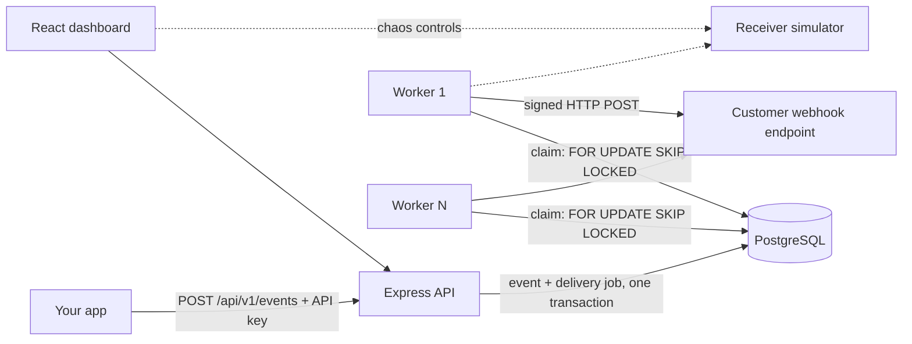

# RelayX — Reliable Webhook Delivery Platform

RelayX receives events from your application and delivers them to your customers' webhook URLs **reliably**:
durable storage, at-least-once delivery, retries with exponential backoff + jitter, dead-lettering, replay,
HMAC signatures, per-tenant API keys and rate limiting — with **PostgreSQL as the job queue** (`FOR UPDATE SKIP LOCKED`).

> **Status honesty:** see [Verification status](#verification-status) for exactly what has and has not been run.

## 1. Problem statement
When system A must tell system B that something happened (`order.created`), B may be down, slow, rejecting requests, or
may receive the same event twice. A naive `fetch()` in the request path loses events during outages. RelayX stores the
event first (durably), then a separate worker delivers it, retries intelligently, and keeps a full audit trail.

## 2. Architecture

Details and more diagrams: [docs/architecture.md](docs/architecture.md).

## 3. Features
| Area | What is implemented |
|---|---|
| Queue | PostgreSQL job queue, `FOR UPDATE SKIP LOCKED`, multiple concurrent workers, lease-based stuck-job recovery |
| Delivery | At-least-once, signed (`HMAC-SHA256`), per-attempt history, `Retry-After` honoured |
| Retries | Exponential backoff + jitter (all values configurable), retryable vs permanent failure classification |
| Dead letter | After max attempts or permanent failure; manual replay creates a **new** delivery, history preserved |
| Idempotency | Unique index `(tenant_id, idempotency_key)`; concurrent duplicates create exactly one event; body-mismatch → 409 |
| Security | Hashed API keys + rotation, tenant scoping on every query, SSRF guard (create-time + DNS-pinned delivery-time), no secrets in logs |
| Rate limiting | Per-tenant fixed window, atomic in PostgreSQL |
| Ops | `/health`, Prometheus `/metrics`, structured JSON logs, graceful SIGTERM/SIGINT shutdown, OpenAPI at `/docs` |
| Demo | React dashboard + receiver simulator with "fail for N seconds" button |

## 4. Technology
Node 22 · TypeScript (strict) · Express · PostgreSQL 16 · Zod · prom-client · Jest + Supertest · React + Vite · Docker Compose · k6 · GitHub Actions.
**Everything runs locally for $0.** AWS is an optional, separate exercise ([docs/AWS_DEPLOYMENT_OPTIONAL.md](docs/AWS_DEPLOYMENT_OPTIONAL.md)).

## 5. Quick start (Docker, zero cost)
```bash
docker compose up --build        # first build takes a few minutes
```
Then open **http://localhost:5173** and sign in with `rx_demo_local_key_0123456789abcdef`.
API docs: http://localhost:3000/docs · Metrics: http://localhost:3000/metrics · Receiver simulator: http://localhost:4000/control/state

Full beginner walkthrough (installing tools, running without Docker, tests, k6): [docs/COMPLETE_SETUP_AND_DEPLOYMENT_GUIDE.md](docs/COMPLETE_SETUP_AND_DEPLOYMENT_GUIDE.md).

## 6. Run checks yourself
```bash
docker compose up -d postgres     # database for the tests
bash scripts/verify.sh            # install, lint, typecheck, unit + integration tests, build (backend + web)
docker compose up --build -d && bash scripts/smoke.sh   # end-to-end behaviour through the real stack
```

## 7. Repository layout
```
backend/            API, worker, receiver simulator (one TypeScript package, one Docker image, three entrypoints)
  src/domain/       pure logic: state machine, backoff, signatures, SSRF rules (unit-tested)
  src/repositories/ all SQL (queue claim lives in queue.ts)
  src/services/     business operations (ingest event, replay, key rotation)
  src/api/          Express app, routes, middleware, OpenAPI
  src/worker/       poll loop, retry decisions, graceful shutdown, SSRF-guarded HTTP client
  tests/            unit/ and integration/ (needs PostgreSQL)
web/                React dashboard
database/migrations SQL schema
load-tests/         k6 scripts
scripts/            verify.sh, smoke.sh, deploy.sh
docs/               guides, architecture, decisions, interview/demo/performance material
```

## 8. Documentation index
[Setup & deployment guide](docs/COMPLETE_SETUP_AND_DEPLOYMENT_GUIDE.md) · [Architecture](docs/architecture.md) · [Database](docs/database.md) ·
[Reliability & failure scenarios](docs/reliability.md) · [API](docs/api.md) · [Security audit](docs/SECURITY.md) ·
[Engineering decisions](docs/ENGINEERING_DECISIONS.md) · [Interview guide](docs/INTERVIEW_GUIDE.md) · [Demo script](docs/DEMO_SCRIPT.md) ·
[Performance testing](docs/PERFORMANCE_TESTING.md) · [Cost & free-tier guide](docs/COST_AND_FREE_TIER_GUIDE.md) ·
[Optional AWS deployment](docs/AWS_DEPLOYMENT_OPTIONAL.md) · [Resume bullets](docs/RESUME_BULLETS.md) · [Portfolio text](docs/PORTFOLIO_DESCRIPTION.md)

## 9. Performance results (measured, with hardware)
Laptop: AMD Ryzen 5 5500U, 8 GB RAM, Docker VM ~2.8 GB; k6 + API + worker + PostgreSQL + receiver all on the same machine. Single 30 s runs — indicative, not a capacity claim.
- **Ingestion:** 150 events/s sustained, p50 15 ms, p95 46 ms, 0 errors; saturation starts between 150 and 200/s (200/s → p95 ≈ 760 ms).
- **Worker throughput:** 1 worker ≈ 69 events/s end to end; 3 workers ≥ 133 events/s (limited by the test producer, not the workers).
- **Reliability under test:** 18,879 events through concurrent workers with 0 lost, 0 duplicated; 201 events through a 2-minute receiver outage all delivered; SIGKILL of a worker recovered via lease (3 jobs, 3 expected at-least-once duplicates); graceful SIGTERM left 0 stuck jobs and 0 duplicates.
- **Bug found by load testing:** 500 simultaneous duplicate-key requests exposed a connection-pool deadlock (467 errors); fixed, regression test added, re-run: 499 duplicates answered, 0 errors.
Full tables and interpretation: [docs/PERFORMANCE_TESTING.md](docs/PERFORMANCE_TESTING.md).

## 10. Engineering trade-offs (short version)
PostgreSQL queue instead of Redis/Kafka (fewer moving parts, transactional enqueue, limited throughput ceiling) ·
at-least-once instead of exactly-once (exactly-once is impossible over an unreliable network; receivers dedupe) ·
fixed-window rate limit (simple and atomic; allows 2× bursts at window edges) ·
fast SHA-256 for API keys (they are 192-bit random, not passwords) ·
signing secrets stored in plaintext (needed to sign; encrypt at rest with a KMS in a real deployment). See [ENGINEERING_DECISIONS](docs/ENGINEERING_DECISIONS.md).

## Verification status
Status of checks:
- ✅ Pure domain logic ran and passed: state machine, backoff + jitter, status classification, HMAC sign/verify (tamper, wrong secret, stale timestamp), request hashing, SSRF address/URL rules (IPv4, IPv6, mapped, metadata IP).
- ✅ Whole backend and test suite type-checked with `tsc` using stubs for packages that could not be installed (this finds syntax errors, bad imports and null-safety slips in project code, **not** misuse of third-party library types).
- ✅ **Run by the project owner on Windows 11/Docker Desktop:** `npm install`, `tsc` type check, ESLint, 88 unit tests, 45 integration tests (queue concurrency, worker, API, receiver) against real PostgreSQL 16, Docker Compose build + full stack, and the manual chaos demo (retries with backoff, recovery, dead-letter, replay, duplicate delivery).
- ✅ k6 experiments 1, 3, 4, 5, 6 (see section 9). A regression test for the connection-pool bug (`tests/integration/pool.test.ts`) was added afterwards.
- ❌ **Still not run:** GitHub Actions workflows, the AWS deployment, `scripts/smoke.sh`.

Run `scripts/verify.sh` and `scripts/smoke.sh`; if anything fails, paste the output and it will be fixed.
