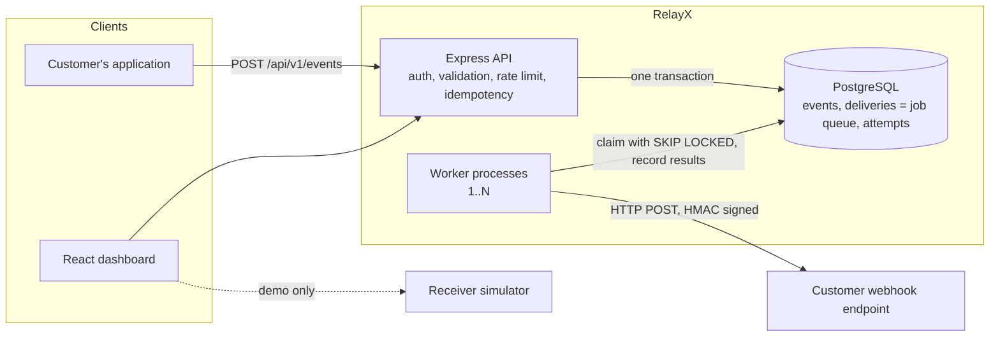
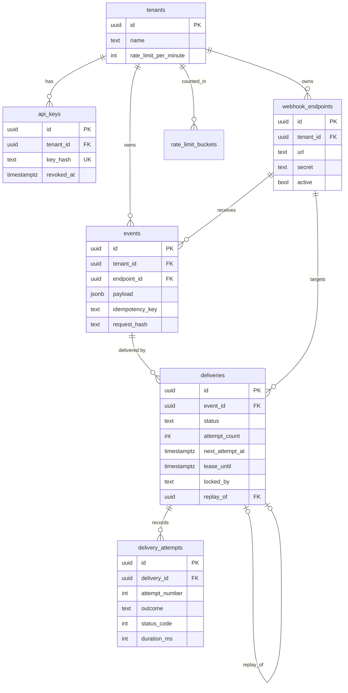
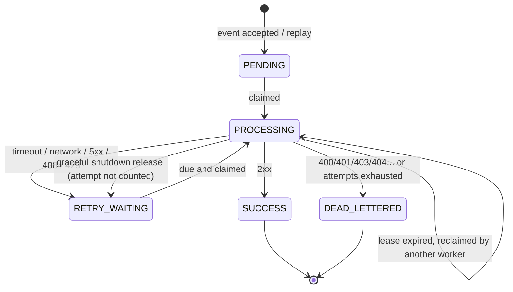
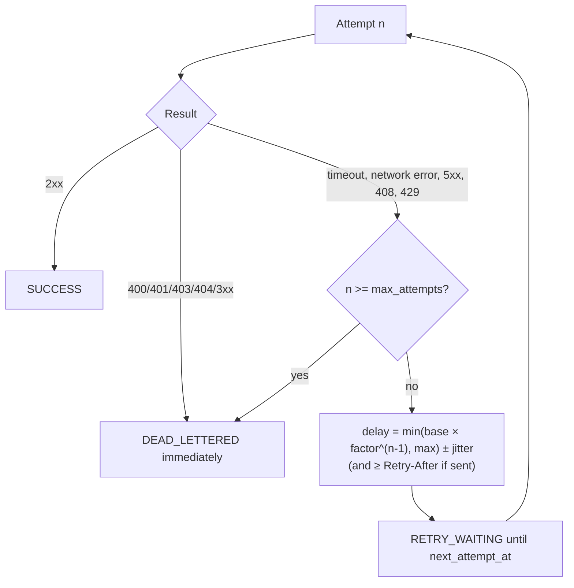
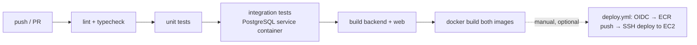
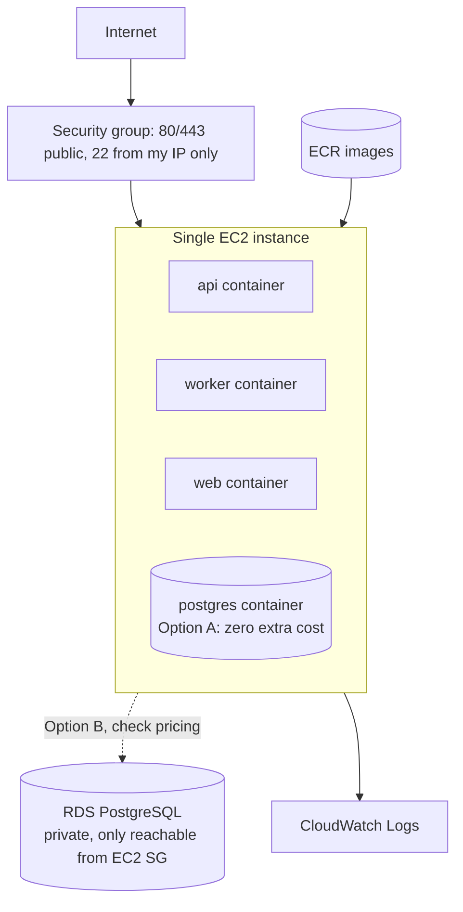

# Architecture

## 1. System architecture

API and workers are **separate processes** sharing only the database. API latency never depends on a customer's server, and workers scale independently.

## 2. Database ER diagram


## 3. Event lifecycle
```mermaid
sequenceDiagram
  participant C as Client
  participant A as API
  participant D as PostgreSQL
  participant W as Worker
  participant R as Receiver
  C->>A: POST /events (API key, idempotencyKey)
  A->>D: BEGIN; check endpoint belongs to tenant
  A->>D: INSERT event ON CONFLICT DO NOTHING
  A->>D: INSERT delivery (PENDING)
  A->>D: COMMIT
  A-->>C: 202 {eventId, deliveryId}
  W->>D: claim (SKIP LOCKED) → PROCESSING, lease
  W->>R: POST signed body
  R-->>W: 200
  W->>D: attempt row + status SUCCESS (one tx, fenced)
```

## 4. Worker / job lifecycle (state machine)

Illegal transitions throw (`domain/state.ts`) and every UPDATE also has a `WHERE status = 'PROCESSING' AND locked_by = ...` guard. The API cannot set a status; the only mutation is `replay`, which inserts a **new** row.

## 5. Retry lifecycle

Defaults: base 5 s, factor 3, max 120 s, jitter ±25 %, 6 attempts → ≈5 s, 15 s, 45 s, 120 s, 120 s.

## 6. CI/CD pipeline

## 7. Optional AWS deployment architecture

